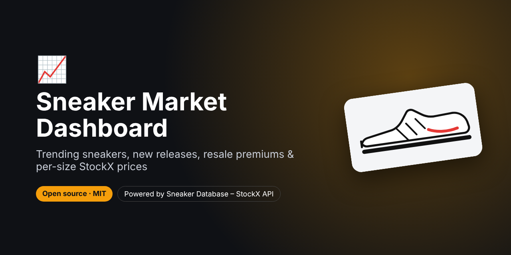
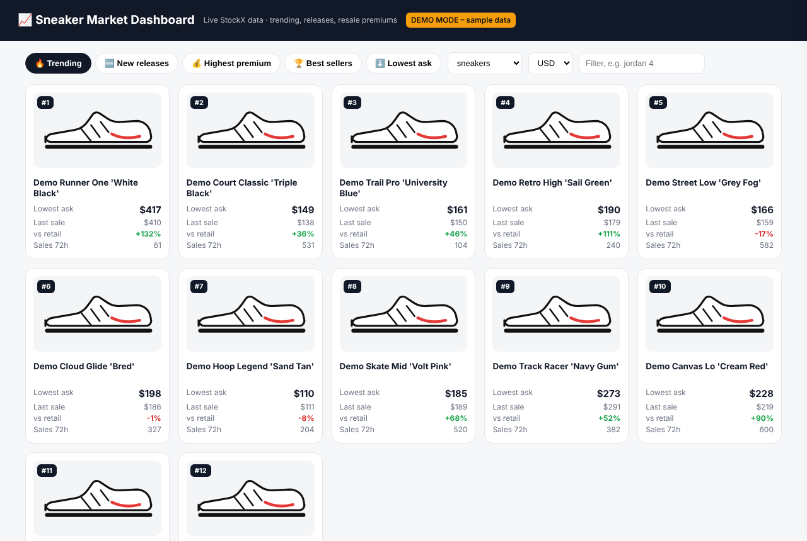
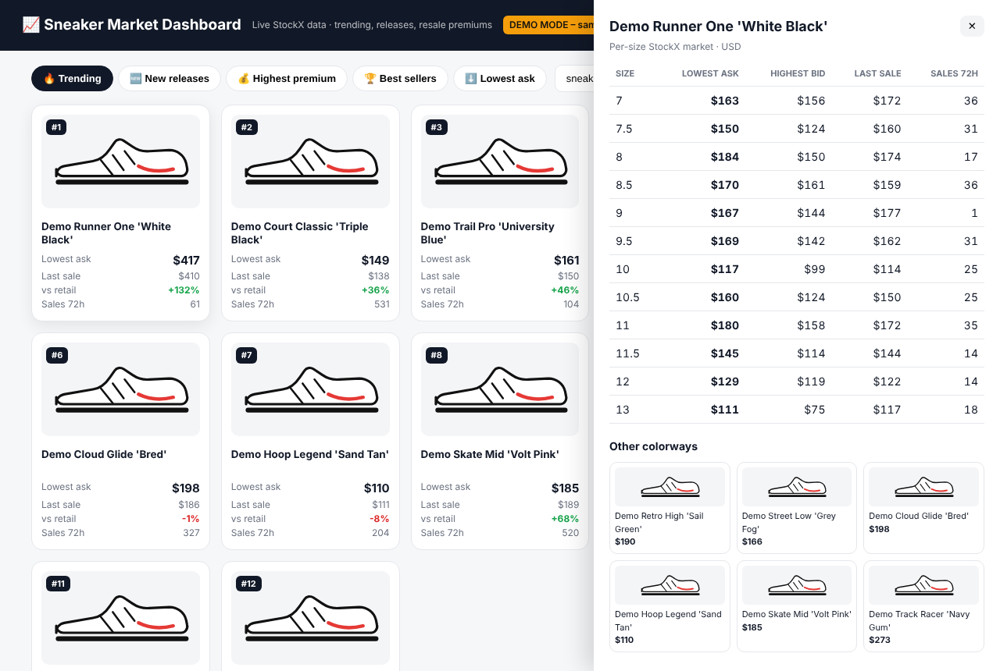
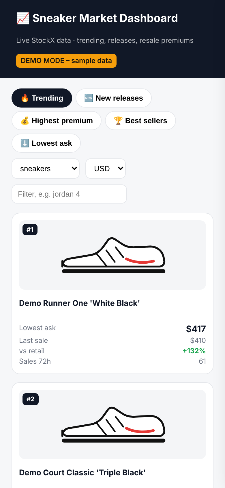

# Sneaker Market Dashboard – Trending Sneakers, New Releases & Resale Prices (StockX)



> **For faster support reply, contact us on Telegram: [@pintoflow](https://t.me/pintoflow)**

A self-hosted **sneaker market dashboard** built on live StockX data. See what's **trending right now**, the **newest releases**, the sneakers with the **highest resale premium** and the **best sellers**, then click any product for **per-size asks, bids and last sales** plus **other colorways**.

It covers sneakers, shoes, apparel, accessories, collectibles, trading cards, electronics and watches, in 6 currencies. It runs on Node.js with **zero dependencies**.

Powered by the **[Sneaker Database – StockX API](https://rapidapi.com/belchiorarkad-FqvHs2EDOtP/api/sneaker-database-stockx)** on RapidAPI (free plan available).







<sub>Screenshots in demo mode with invented sample products.</sub>

---

## Features

- 🔥 **Trending**: most active products on StockX right now
- 🆕 **New releases**: sorted by release date
- 💰 **Highest premium**: the biggest resale markup over retail
- 🏆 **Best sellers**: the most sold products
- ⬇️ **Lowest ask**: the cheapest products first
- 🔎 Keyword filter (e.g. `jordan 4`), 8 categories, 6 currencies
- 📐 **Per-size drawer**: lowest ask, highest bid, last sale and sales in the last 72 h
- 🎨 **Colorways** of the same model
- 📱 Works on mobile
- 🔒 Your API key stays on the server, with caching that matches the API
- 🧪 **Demo mode** with sample data, so you can try it without a key

## Quick start

```bash
git clone https://github.com/BelNaruto/sneaker-market-dashboard.git
cd sneaker-market-dashboard

node server.js                              # demo mode
RAPIDAPI_KEY=your_rapidapi_key node server.js   # live data
```

Open **http://localhost:3001**. Requires Node.js 18 or newer, and there's nothing to install.

Get a key: **https://rapidapi.com/belchiorarkad-FqvHs2EDOtP/api/sneaker-database-stockx**

## Ideas for what to build on top

- A **sneaker blog or affiliate site** with an always-fresh "trending sneakers this week" page
- A **resell research tool**: sort by price premium to find what's worth flipping
- **Embed** the trending grid on a Shopify or WordPress store
- **Daily trend snapshots** saved to a database to chart price history

## API endpoints used

| Endpoint | Used for |
|---|---|
| `GET /stockx/browse?category=…&sort=…&query=…` | Trending, new releases, premium, best sellers |
| `GET /stockx/market-data?urlKey=…&currency=…` | Per-size asks, bids, last sale, 72 h sales |
| `GET /stockx/colorways?urlKey=…` | Other colorways of the model |

The server only forwards these three routes and their documented params. It caches browse for 10 min, market data for 5 min and colorways for 1 h.

## Deploy

One Node.js file and one HTML file. Deploy to **Google Cloud Run, Render, Railway, Fly.io** or any VPS with start command `node server.js` and the env var `RAPIDAPI_KEY`.

## Related projects

- 💰 [Sneaker Resell Profit Calculator](https://github.com/BelNaruto/sneaker-resell-profit-calculator): StockX vs GOAT vs Flight Club payout per size
- 🔔 [Sneaker Price Alert Bot](https://github.com/BelNaruto/sneaker-price-alert-bot): Discord and Telegram alerts when a StockX price drops
- 📘 [StockX Sneaker Price API docs and examples](https://github.com/BelNaruto/stockx-sneaker-price-api)

## Support

> **For faster support reply, contact us on Telegram: [@pintoflow](https://t.me/pintoflow)**

API: https://rapidapi.com/belchiorarkad-FqvHs2EDOtP/api/sneaker-database-stockx

---

MIT License. Not affiliated with, endorsed by or sponsored by StockX.

**Keywords:** sneaker dashboard, trending sneakers, stockx trending, sneaker release dates, new sneaker releases, sneaker resale prices, stockx market data, hype sneakers, sneaker price premium, stockx api
